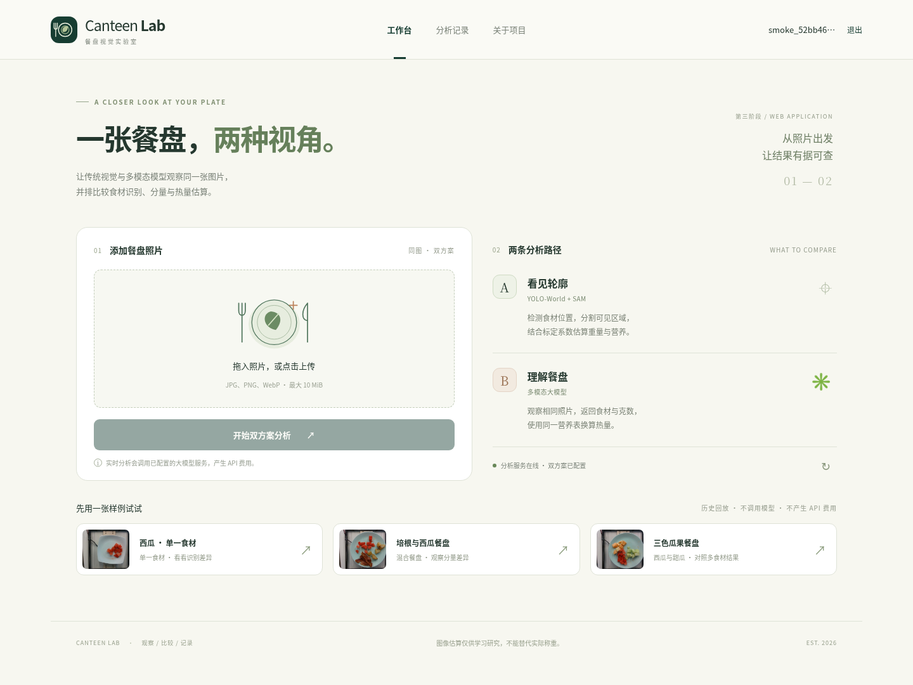

# Canteen Lab：双方案餐盘分析

第三阶段在原实验上新增可操作的 Web 应用：照片上传、YOLO-World＋SAM 与多模态模型并排分析、JWT 登录、个人记录、失败重试，以及数据库和异步队列。开发启动方式见 [Web 应用说明](web/README.md)。二阶段脚本、原始回复和实验结果继续保留，下文记录其复现与数据依据。



不购买服务器、不调用付费 API 的本机公网演示方式见 [免费部署说明](docs/free-public-web.md)。该方式需要自己的电脑保持开机；实际公网链接须在启动成功后验证，当前尚未发布。

## 启动三阶段 Web

在安装了 Docker Engine 和 Compose v2 的 Linux 主机或 Docker Desktop 环境中：

```bash
git clone https://github.com/helloshen007/canteen-kcal.git
cd canteen-kcal
cp .env.example .env
docker compose up --build -d
docker compose ps
```

浏览器访问宿主机 8080 端口，注册后即可体验历史样例回放。实时分析还需准备模型，并在本地 `.env` 配置 VLM 密钥：

```bash
docker compose run --rm worker python -m web.prepare_models
# 在本地 .env 填入 VLM_API_KEY，再应用配置；密钥不要入库。
docker compose up -d
```

默认只监听服务器回环地址，远程使用可通过 SSH 转发；公网 HTTPS、代理和持久化配置见 [Linux / Docker 部署说明](docs/deployment.md)。API 文档位于 `/docs`。上传后的任务由 Redis＋RQ 在后台处理，历史记录和图片保存在数据卷；失败不会当作正常零值，可单独重试失败方案。

[三阶段项目说明与工程复盘](docs/stage3.md) · [新版运行视频](docs/stage3-video/README.md) · [两次真实上传的逐图结果和 raw 回复](evidence/stage3-live/README.md) · [实跑环境与验证记录](docs/stage3-run.json)

本轮已实际运行四个容器，53 项测试在本地和容器内通过；接口与浏览器各完成一次真实双模型分析，并验证整套服务重建后账号、图片、会话及排队任务恢复。历史回放、实时上传和二阶段总体指标分别保留来源，具体误识别与估重误差也如实展示。

## 二阶段实验背景

同一组 Nutrition5k 餐盘图片，比较 YOLO-World＋SAM 与多模态大模型输出的食材、重量及热量。两方案共用修正后的词表、营养表和测试集。

## 二阶段标注修正与证据状态

- 固定 60 张图，前 40 张标定、后 20 张测试；划分未改变。
- 按食材 ID 核对六张测试图：`ingr_0000000458` 为可见西瓜，不能因原名称 `deprecated` 而排除。另一个同名 ID 并非同一类，不能全局替换。
- 词表为 **24 类**，测试集为 **15 张单一食材、5 张多食材**。详细原图、标注来源与修正差异见 [标注审计](docs/annotation-audit.md)、[六图对照](docs/annotation-contact-sheet.jpg)、[逐图修正 CSV](docs/annotation-corrections.csv)。映射有人工核对依据，未冒称已访问被阻断的官方 GCS 原表。
- 错误 JSON、重复键、失败状态、缺字段、未知食材、非法重量均视为失败，不保存成“无食材、零热量”。只有通过校验、没有失败标记的显式 `{"items":[]}` 可作为成功空预测。失败回复单独保留，下次运行会重试；过期缓存隔离保存。
- 真值、营养表、词表和图片变化会使旧缓存失效。成功预测记录上下文、原始回复、模型、提示词和耗时。失败不参与指标，也不当作零预测。
- 原汇总表已移到 [历史存档](docs/historical-results.md)，不得用于当前性能结论。本轮已真实调用 DeepSeek 60 次并保存全部原始回复，不沿用或补造旧汇总表的逐图数据。

修正后的完整 A/B 复验：[新结果表](docs/results.md)、[40 行逐图误差](docs/results.per-image.csv)、[逐图预测、全部 B 原始回复及运行记录](evidence/revalidated/README.md)。A/B 均覆盖 20/20 测试图，B 每图重复 3 次，60 次调用全部成功、失败记录为 0。

[运行演示视频](docs/video/demo.mp4)展示当前应用的原图、检测分割和真值/A/B 并排结果，[录制说明](docs/video/README.md)列出案例及演示范围。

| 本轮方案 | 菜名 F1 | 热量 MAE(kcal) | 重量 MAE(g) |
|---|---:|---:|---:|
| A YOLO-World＋SAM | 0.2450 | 62.16 | 65.80 |
| B DeepSeek V4.1 Flash | 0.9889 | 17.38 | 17.90 |

基线热量 MAE 为 70.69 kcal；B 同图重复热量标准差均值为 10.40 kcal。B 使用的正式 API ID 是 `deepseek-flash`，服务版本与官方依据见 [DeepSeek 配置说明](docs/deepseek-service.md)。

## 方案与限制

A：英文食材词表 → YOLO-World 检测 → 跨类别 NMS → 检测框提示 SAM → 同类掩膜并集 → 标定集估计像素/克系数 → 共用营养表。

B：多模态服务只输出闭集食材名与克数 → 校验 JSON → 用同一营养表换算营养。服务必须支持图像输入，不能仅根据服务商名称推断模型能力。

图片为固定环境的俯拍子集，不能外推至真实中式食堂。两种方法都是估重而非称重。历史阈值 0.05 曾参考测试集选择；本轮修复沿用它以避免新增调参，并未消除原方法学局限。严格后续实验应在标定集选择阈值，再冻结测试。

| 对比点 | A：YOLO-World＋SAM | B：多模态大模型 API |
|---|---|---|
| 使用体验 | 需要下载权重、处理框与掩膜、拟合面积到克数；CPU 完整运行较慢，但可查看具体定位依据。 | 接入及调整提示词较快；需要联网、调用费用和严格输出校验，同图重量会波动。 |
| 适用场景 | 需要检测框/掩膜、可控的本地处理流程，且能针对目标食材补充标注和训练的数据场景。 | 快速验证食材语义识别、原型展示和少量图片分析，且允许使用外部服务的场景。 |
| 当前限制 | 本轮识别 F1 仅 0.2450；像素面积无法直接反映厚度、密度，不能直接用于可靠膳食计量。 | 本轮闭集识别较好，但仍不等于称重；服务版本、成本、延迟和输出稳定性都需要管理。 |

## 完整复现

建议 Python 3.12，在项目根目录运行。CPU 可以运行 A，但完整提取较慢。先创建虚拟环境并安装依赖；如无需 GPU，可先从官方 CPU 源安装 torch/torchvision。

```bash
python -m venv .venv
# Linux/macOS 激活；Windows 使用 .venv\Scripts\activate
source .venv/bin/activate
python -m pip install -r requirements.txt
python -m pip install 'git+https://github.com/ultralytics/CLIP.git'

# 固定版本下载全部原图与 metadata.jsonl，校验元数据，不改 dish_ids.json
python -m data.prepare
# 显式生成经 ID 修正的真值及营养表
python -m data.build_gt

# 新实验目录，保留旧结果以供审计
python -m detector.extract --results-root results/revalidated
python -m detector.fit_eval 0.05 --results-root results/revalidated

# 复制 .env.example 为 .env，在本地/环境设置中填写真实配置，不提交密钥
# 先做单图单次调用（产生 API 费用）
python -m vlm.run_vlm 1 --limit 1 --results-root results/revalidated
# 确认服务正常后，20 张测试图各运行 3 次（产生 API 费用）
python -m vlm.run_vlm 3 --results-root results/revalidated

# 默认要求两方案全部测试图有有效结果，不覆盖历史表
python -m compare.report --results-root results/revalidated --output results/revalidated/report.md
# 仅复验 A 时可明确生成部分报告：会列出缺失 B，不伪装完整比较
python -m compare.report --results-root results/revalidated --allow-partial --output results/revalidated/partial-report.md

python app.py --results-root results/revalidated
python -m unittest discover -s tests -v
```

`.env` 由 `vlm` 包加载，现有环境变量优先。`VLM_PROVIDER` 使用 `openai` 或 `anthropic`，还需 `VLM_API_KEY` 和准确的 `VLM_MODEL`；OpenAI 兼容服务填写 `VLM_BASE_URL`。当前 DeepSeek 官方接口支持 `thinking.type=disabled`；本轮设置 `VLM_DISABLE_THINKING=1`。本项目对该官方接口默认关闭思考，其他接口仍需确认参数支持；显式设置 `0` 可保留思考。失败日志不保存 HTTP 异常正文，避免回显密钥；原始模型文本共享前仍应检查敏感信息。

成功记录为 `vlm/<image_id>_rN.json`，展示副本为 `<image_id>.json`；无效旧缓存和失败请求在 `vlm/failures/`。只有输出、数据版本和实验配置均通过校验才跳过调用。更换模型或提示词、重建标注后，建议改用独立结果目录。

详细环境、数据、模型和故障说明见 [复现文档](docs/reproduction.md)。初次模型权重下载需联网，保留 TLS 及模型内置校验。

## 逐图结果与原始回复

本轮 A/B 真实复验结果及标注版本已存入 `evidence/revalidated/`：A 的 60 份逐图预测，B 的 60 份重复预测及原始 `raw` 回复（另有 20 份展示副本），并保留逐图评估和运行配置。全部模型特征和原图可从数据准备脚本及完整证据 ZIP 恢复。

```bash
python tools/export_evidence.py --results-root results/revalidated --output results/revalidated/evidence.zip
```

导出包仅包含白名单预测、原始回复、失败记录及复算材料，manifest 列明成功/失败/缺失。默认不包含密钥、`.env`、权重或虚拟环境。数据导出不等于实验成功，指标以经过校验的当前版本结果为准。

原项目介绍及个人感悟见 [文档说明](docs/文档说明.md)，其中旧实验数字已明确标记为历史。估算仅供参考，不构成医疗或膳食建议。

服务端点会以 SHA-256 摘要加入缓存/实验签名，切换接口地址不会复用同名模型的旧结果，也不在记录中暴露地址内的凭据。
