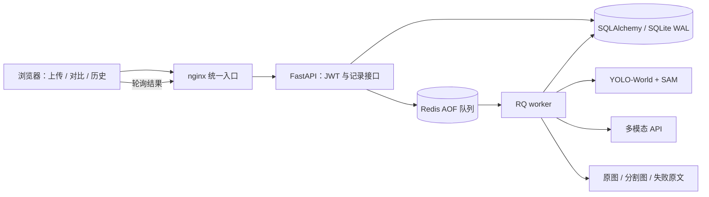

# 三阶段：把餐盘对比实验做成 Web 应用

三阶段沿用二阶段的同图双方案问题：一张餐盘照片，比较 YOLO-World＋SAM 与多模态模型识别的食材、估算重量和营养。原来的 Gradio 页面读取固定实验结果；新增的 Canteen Lab 页面支持上传新照片，在后台运行模型，并按账号保存记录。

## 实际使用

打开工作台，注册或登录账号后，可以上传 JPG、PNG 或 WebP 图片。提交后接口立即返回任务编号，页面轮询显示排队、A/B 处理与完成状态。离开页面后，任务仍由独立 worker 执行，可在“分析记录”找回。

完成后，A 列展示检测框、SAM 掩膜与营养估算；B 列展示相同输入的结果，并可展开原始模型回复。每条记录可改标题、写备注、导出 JSON，完成后可删除。发生错误时显示明确失败，允许只重试失败方案，保留另一方案的成功结果。

首页三个样例来自修正标注后的二阶段真实实验，明确标记为“历史样例回放”。回放也经过任务队列和数据库，但不重新调用模型或付费 API。上传入口始终执行实时分析。

## 服务结构

nginx、API、worker、Redis 由 Compose 管理。推理不在 HTTP 请求内阻塞执行；RQ 使用独立进程消费持久化队列。SQLite 开启 WAL、外键及 busy timeout，供小规模应用中的 API 和单 worker 共享；数据库、照片和会话密钥使用 `state` 卷，模型使用 `models` 卷，Redis AOF 使用 `queue` 卷。

该部署面向单机、单推理 worker。大量并发、跨机器扩展或高可用部署，应进一步使用 PostgreSQL、对象存储及更多有资源隔离的 worker，而不是直接复制 SQLite 文件到多台机器。

## 两个模型如何复用

实时分析先处理图片方向，再按比例缩放并补边到 640×480，A/B 都读取这份相同的 PNG。选择该尺寸是因为原数据和面积标定使用此分辨率。原图另行保留，上传文件 SHA-256 随记录保存。

A 复用二阶段的 24 类词表、跨类别 NMS、SAM 框提示分割、同类掩膜并集，以及只用 40 张标定图拟合的冻结系数。模型只在 worker 中加载，并在后续任务间复用。模型准备入口检查 YOLO、SAM、CLIP 的 SHA-256，避免更换权重后仍称为同一版本。

B 复用严格 JSON 解析、闭集名称与非负有限重量校验，再查同一营养表。每次任务中最多请求两次，失败原文写入任务目录，成功结果保留 raw、提示词、模型名、数据版本和尝试次数。SDK 隐式重试关闭，由项目显式控制次数；单次网络超时为 120 秒。

二阶段 20 张测试图的总体指标继续由其逐图证据复算；三阶段新增单张真实联调记录，用于验证从上传到双模型结果的完整链路。新版视频、截图和本次真实结果位于 `docs/stage3-video/`、`docs/images/` 与 `evidence/stage3-live/`。

## 记录、认证与接口

`users` 表存用户名、加盐 PBKDF2-SHA256 哈希及 token 版本；`comparisons` 表存图片摘要、任务状态、两种方法的结果、错误、尝试次数及记录备注。JWT 有效期 12 小时，通过 HttpOnly、SameSite=Strict cookie 传递；退出会更新 token 版本，撤销该账号此前的令牌。HTTPS 部署启用 Secure cookie。

每个读取、修改、删除、重试和文件接口都查询记录所属用户。未授权账号不能通过猜测任务编号读取图片；私有文件不放在公共静态目录。页面不接收服务密钥，API 也不会返回密钥。上传内容由 Pillow 校验实际格式、解码、体积和像素数，文件名只作为显示文本。

| 接口 | 用途 |
|---|---|
| `POST /api/auth/register`、`POST /api/auth/login` | 注册、登录，设置安全会话 cookie |
| `GET /api/auth/me`、`POST /api/auth/logout` | 获取当前用户、退出并撤销令牌 |
| `POST /api/jobs` | 上传图片，返回 202 及任务编号 |
| `POST /api/jobs/from-sample` | 创建历史回放，或显式选择 live 重新分析样例 |
| `GET /api/jobs`、`GET /api/jobs/{id}` | 分页历史与完整结果 |
| `PATCH /api/jobs/{id}`、`DELETE /api/jobs/{id}` | 修改标题备注、删除已完成记录及图片 |
| `POST /api/jobs/{id}/retry` | 只重试失败方法 |
| `GET /api/jobs/{id}/image`、`.../overlay` | 当前用户可见的原图、检测分割图 |
| `GET /api/health` | 数据库、队列、worker 和配置就绪情况 |

完整请求结构见 `/docs` 与 `/openapi.json`。浏览器同源访问，无需开放跨来源权限；写入接口拒绝不匹配的 Origin。nginx 对登录相关接口限流，只有 nginx 的 Web 端口发布到宿主机。

## 状态与故障处理

一条任务的状态为 `queued → running → succeeded / partial / failed`；A/B 各有独立状态和结果。创建记录后若队列不可用，会保留图片并将未提交部分标为失败，恢复后可重试。单方法异常保留 `NULL` 结果，而不是空食材或零热量。

重试增加 generation，并仅将失败方法重置为 pending。worker 使用数据库条件更新领取任务和写回结果，重复投递与旧 generation 不会覆盖新结果。RQ 总任务超时会单独处理并向队列重新抛出；不会当成普通模型错误吞掉。已成功的方法不会在重试中再次运行。

## 本轮工程复盘

从脚本到 Web，主要变化是要明确“请求被接收”和“分析真正成功”的区别。202 只能说明任务已创建；页面必须继续查状态，数据库也必须区分等待、部分失败和成功。

缓存的边界同样需要放进产品。二阶段已有的原始回复可用于历史展示，但若用户上传新图片，必须走新推理。把回放作为单独入口，并在结果上保留来源，比仅根据文件存在就跳过运行更容易解释和排错。

部署过程中实际遇到了两类环境问题：云环境代理需要在容器中正确配置可信 CA 和域名解析；nginx 使用非 root 用户运行时，复制进镜像的配置文件必须具备相应读取权限。前者通过现有信任根和代理配置解决，后者通过明确的文件权限解决，均未关闭 TLS 校验或改用特权容器。

本地功能测试、容器内测试、真实 HTTP 联调和浏览器操作分别验证不同边界。具体运行版本、输出及视频说明保留在项目中，个人对模型原理和代码的理解仍需结合实际运行与修改来形成。

## 仍然存在的局限

图像面积和单张照片无法可靠反映厚度、密度或遮挡；固定俯拍标定不适用于所有新图片。A 的原阈值曾参考测试集选择，其方法学局限继续保留。大模型按次收费，并存在服务版本变化与估重波动。系统保存失败及原始回复，使这些限制可以被观察，不把它们隐藏为正常零值。

服务器部署、数据卷、代理、HTTPS 和排错命令见 [部署说明](deployment.md)。原二阶段个人感悟保留在 [文档说明](文档说明.md)。
